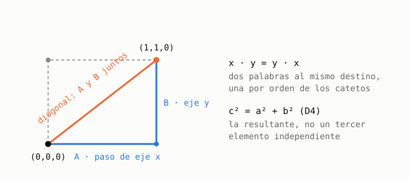

# El enlace en un cristal: qué está probado y qué no

**Tesis.** La diagonal no es un paso primitivo con operador propio, pero sí es un enlace efectivo bien definido, y es la
única palabra de segundo orden en la que dos ejes aparecen en el mismo enunciado. Todo lo que sigue se puede reproducir;
lo que no está probado está marcado como tal.

## 1. Lo que está en Lean

| Enunciado | Nombre | Dónde |
|---|---|---|
| Los operadores de ejes distintos conmutan | `bracket_alongX_alongY`, `…_alongX_alongZ`, `…_alongY_alongZ` | PhyslibAlpha, #1725 |
| En el estado de corriente máxima del cubo, las covarianzas entre ejes son 0 | `covariance_alongX_alongY` (y XZ, YZ) | PhyslibAlpha, #1725 |
| `Ω` y `Σ` son diagonales por bloques, un bloque por eje | `bracketMatrix_cubePairs`, `covarianceMatrix_maxCurrentCubeState` | PhyslibAlpha, #1725, #1742 |
| El paso de eje es estrictamente el más corto (1 < √2 < √3); con un solo eje no hay diagonal | `OrthogonalStep.minimal_adjacency_is_orthogonal`, `DiagonalNeedsTwoAxes.no_diagonal_of_one_axis` | corpus NRS, `D4_WhyNotDiagonal.lean` |
| Censo de palabras de dos pasos: 6 de regreso, 12·2 de diagonal de cara, 6 de doble eje, total 36 | `palabras2_regreso`, `palabras2_diagonalCara`, `palabras2_dobleEje`, `suma_palabras2` | este repo, `Schur.lean` (`decide`) |
| Cada paso de eje cambia la paridad: `H_PP = H_QQ = 0` en FCC | `not_even_iff_of_mem_vecinos` | este repo |
| El complemento de Schur de FCC es exacto, sin serie | `det_sub_bipartita`, `schur_bipartita` | este repo |
| En BCC la diagonal de cuerpo no se alcanza en 2 pasos y sí en 3 (6 palabras) | `palabras2_cuerpo`, `palabras3_cuerpo` | este repo |
| Con transporte real y amplitudes reales la tensión es 0 | `tension_eq_zero_of_real`, `tension_parteFCC_eq_zero` | este repo |
| Cubo: cada eje conserva su defecto `T_d:P_d`; estricto desde 4 × 4 × 4 | `robertson_schrodinger_cube`, `det_covarianceMatrix_maxCurrentCubeState` | PhyslibAlpha, #1725, #1742 |

## 2. El argumento, en cuatro pasos

1. **Los ejes conmutan** (#1725). Por eso `x` y luego `y` llega al mismo sitio que `y` y luego `x`.
2. **Censo.** De las 36 palabras de dos pasos, 6 de regreso y 6 de doble eje usan un solo eje; las 24 palabras de diagonal de cara
   (12 diagonales, 2 palabras cada una, una por orden) son las únicas con dos ejes distintos.
3. **FCC es la subred par**, y el complemento de Schur es exacto: la dinámica efectiva sobre FCC es `H_PQ H_QP / E`, cuyas
   entradas son exactamente ese censo.
4. **La diagonal tiene dos lecturas que coinciden.** Geométrica: dos estados que se distinguen son ortogonales y Pitágoras cierra el
   triángulo (la resultante). Algebraica: es el primer enunciado que lleva A y B juntos. No es un tercer elemento independiente.

## 3. Dos tipos de pares (no mezclarlos)

| Par | Qué es | `Ω` | Cota |
|---|---|---|---|
| Conjugado `(T_d, P_d)`, `(H, X)` de un eje | no conmutan | `≠ 0` | Robertson–Schrödinger, defecto estricto desde N ≥ 4 |
| De ejes `(x, y)` | conmutan | `= 0` | solo positividad de la matriz de Gram |

La diagonal es del segundo tipo. El defecto `T_d:P_d` de cada eje se conserva tal cual.

## 4. Flancos abiertos (dónde se puede objetar)

- **Hopping directo.** D4 prueba que el paso de eje es el más corto; no prueba que un Hamiltoniano no pueda tener un término
  diagonal directo. No se afirma «no se puede»: se afirma «no hace falta postularlo, sale derivado».
- **El grafo de FCC no es `H_PQ H_QP`.** El efectivo además tiene el regreso (6) y la segunda capa `±2eᵢ` (peso 1). El grafo de
  12 vecinos es el truncamiento a primeros vecinos.
- **Falta un lema** que diga en una línea que las únicas palabras de segundo orden con dos ejes son las diagonales de cara.
  Sale del censo, pero no está escrito.
- **El (1,1,0) con observables que mezclan ejes, o con estados que no son producto, no está en Lean.** `cubePairs` contiene solo los
  seis `(H_eje, X_eje)`.
- **Un solo eje con N ≥ 4 basta para el determinante.** Sale de la identidad `det_covarianceMatrix_maxCurrentCubeState`, que pide
  `2 ≤ N`; el lema `robertson_det_maxCurrentCubeState_strict` pide `4 ≤ N` en los tres. No está escrito como lema.

## 5. Qué proponer en el PR 4 (fcc/bcc)

- Definiciones y conteo (`fcc_neighbors_card = 12`, `bcc_neighbors_card = 8`) con la API de `Bond` y `PeriodicGraph`, sin tocarla.
- El docstring dice solo que los vecinos son combinaciones enteras de los vectores primitivos, sin la palabra «diagonal».
- Las palabras de pasos de eje se quedan en este repo.

## 6. Revisión con Tom (plan de 9 PR en Physlib)

| # | Contenido | Estado |
|---|---|---|
| 1 | Bravais general | fusionado, [#1961](https://github.com/leanprover-community/physlib/pull/1961) |
| 2 | longitudes de enlace + cadena, cuadrada, cúbica | **abierto, para revisión de Tom:** [#1972](https://github.com/leanprover-community/physlib/pull/1972) |
| 3 | triangular + hexagonal | rama local `feat-crystal-triangular-hexagonal` (`990e18b5`), compila; apilada sobre #1972, se rebasa al fusionarse |
| 4 | fcc + bcc | sin escribir; antes, acordar con Tom el docstring (§5) |
| 5–9 | ortorrómbicas, tetragonal + romboédrica, monoclínica + triclínica, panal + diamante, hcp | pendientes; en PhyslibAlpha ya están fusionados los enunciados de las redes |
