<div lang="fr">

<div align="center">

# RS<sup>N</sup>³ · Cristaux
### La symétrie donne la forme de Σ et Ω ; le spectre donne la taille ; le pas d’axe engendre fcc et bcc

**Eduardo Nava Hernández**  
*Vérification formelle en Lean 4 · 0 sorry · Physlib (PhyslibAlpha)*

[](https://leanprover.github.io/)
[](https://github.com/leanprover-community/mathlib4)
[](Verification/Axioms.lean)
[](https://github.com/leanprover-community/physlib/pulls?q=is%3Apr+is%3Amerged+author%3Anaype888-cloud)
[](https://naype888-cloud.github.io/nrs3-cristales/)

**[▶ Le site](https://naype888-cloud.github.io/nrs3-cristales/)** · [Didactique, en huit pas](https://naype888-cloud.github.io/nrs3-cristales/didactic/) · [Note formelle, avec le livre de lemmes](https://naype888-cloud.github.io/nrs3-cristales/formal/) · [Laboratoire : les réseaux et tous leurs paramètres](https://naype888-cloud.github.io/nrs3-cristales/lab/)

</div>

---

> ### 🏛️ Le module maître : la forme, la taille, le pont, le pas d’axe
>
> Tout réseau de Bravais est symétrique par l’inversion n ↦ −n. Avec le renversement du temps, cela force énergie et position à ne pas se corréler dans toute onde plane : Σ_HX = 0. L’entrée qui survit, Ω_HX = ⟨⁅H, X⁆⟩, est une somme sur les liaisons ; sur les grandes boîtes elle tend vers −½ fois la vitesse de groupe de la bande. La relation de Robertson (1934) vaut dans tout état d’une \*-algèbre. Enfin, les voisins de fcc et de bcc sont des mots de pas d’axe : le complément de Schur du cube est exact pour fcc.
>
> <div align="center">
> <picture><source media="(prefers-color-scheme: dark)" srcset="assets/oscuro/plaque_cr_maitresse.png">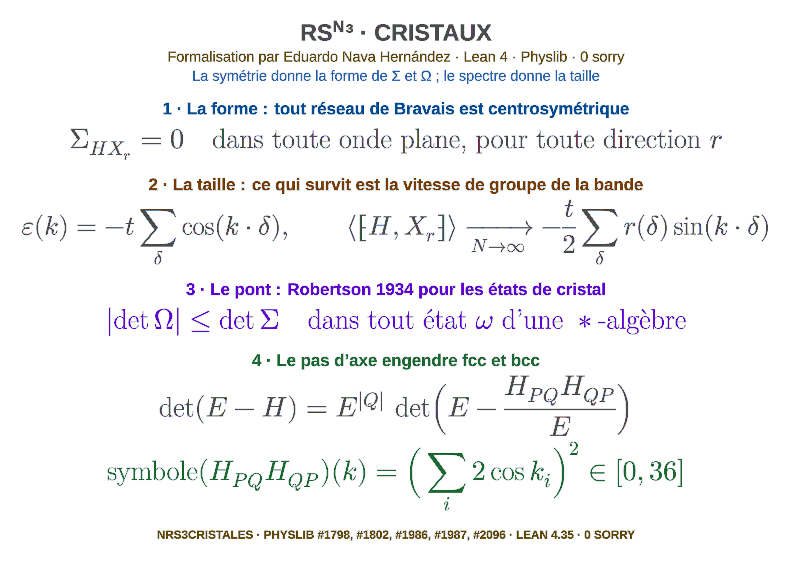</picture>
> </div>
>
> **1 · La forme.** Inversion et renversement du temps : Σ_HX = 0 dans toute onde plane, pour toute direction ; le petit groupe de chaque moment annule aussi des entrées de Ω.
>
> **2 · La taille.** ε(k) = −t ∑_δ cos(k·δ) ; sur {0, …, N}^d, ⟨⁅H, X_r⁆⟩ → −(t/2) ∑_δ r(δ) sin(k·δ), soit −½ fois la dérivée de ε le long de r.
>
> **3 · Le pont.** |det Ω| ≤ det Σ dans tout état d’une \*-algèbre, en particulier dans les états de cristal.
>
> **4 · Le pas d’axe.** Sur le sous-réseau pair de ℤ³ (fcc), det(E − H) = E^|Q| det(E − H_PQ H_QP / E), et le symbole de H_PQ H_QP est (2 cos k₁ + 2 cos k₂ + 2 cos k₃)².

<div align="center">
<picture><source media="(prefers-color-scheme: dark)" srcset="docs/figures/oscuro/cristales.png">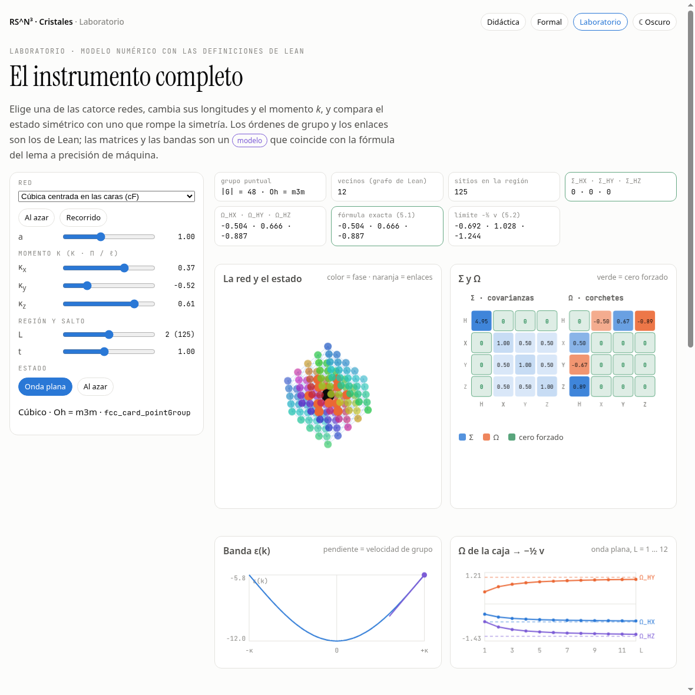</picture>
</div>

---

## ⚡ Résumé formel

Le dépôt a sept fichiers Lean, tous dans [NRS3Cristales/](NRS3Cristales) ; ils compilent avec `lake build` (3306 tâches) et [`Verification/Axioms.lean`](Verification/Axioms.lean) imprime pour chaque résultat les seuls axiomes `propext`, `Classical.choice`, `Quot.sound`.

* [`Resumen.lean`](NRS3Cristales/Resumen.lean) ré-énonce, avec un `example` chacun, les lemmes de la bibliothèque utilisés : il ne compile que si les lemmes disent exactement cela.
* [`Diagonal.lean`](NRS3Cristales/Diagonal.lean) : le petit groupe sur la diagonale du réseau carré (`omega_diagonal`).
* [`Palabras.lean`](NRS3Cristales/Palabras.lean) et [`PalabrasCubo.lean`](NRS3Cristales/PalabrasCubo.lean) : commuter, c’est un seul mot ; ne pas commuter, deux mots.
* [`Schur.lean`](NRS3Cristales/Schur.lean) : le complément de Schur du cube ; les voisins de fcc et bcc sont des mots de pas d’axe.
* [`SchurCubo.lean`](NRS3Cristales/SchurCubo.lean) : la partie fcc de l’état de courant maximal ne porte pas de tension.
* [`FccRefinado.lean`](NRS3Cristales/FccRefinado.lean) : la bande fcc raffinée est le carré de la bande cubique.

Les lemmes de bibliothèque viennent de Physlib : les groupes ponctuels, Robertson dans une \*-algèbre et le cube sont fusionnés dans `leanprover-community/physlib` ; l’inversion, la vitesse de groupe et le petit groupe sont dans la branche [`cristales-435`](https://github.com/naype888-cloud/physlib/tree/cristales-435) du fork (`master` de Physlib plus `mosaic-cristales`, Lean 4.35), au commit `cede8e00` fixé par lakefile.toml. Le graphe de Cayley, les chemins et le produit cartésien de graphes viennent de Mathlib.

---

## 📐 Chaîne déductive en huit étapes

<div align="center">
<picture><source media="(prefers-color-scheme: dark)" srcset="assets/oscuro/plaque_cr_etapes.png">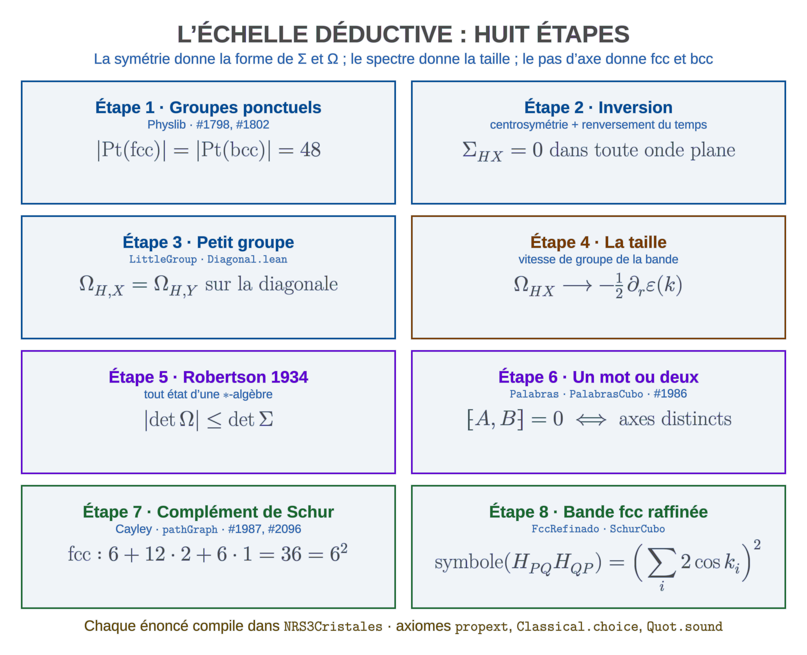</picture>
</div>

### Étape 1 : Les réseaux et leurs groupes ponctuels

> **Proposition 1.1 (Ordres des groupes ponctuels).** Le réseau cubique simple de ℤ³ a un groupe ponctuel d’ordre 2³ · 3! = 48, comme bcc et fcc ; les tétragonaux simple et centré, 16 ; l’hexagonal, 24 ; les quatre orthorhombiques P, C, I, F, 8.

<div align="center"><picture><source media="(prefers-color-scheme: dark)" srcset="assets/oscuro/plaque_cr_etape1.png">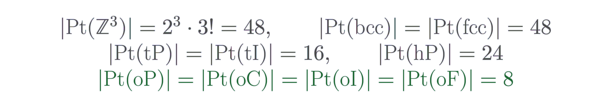</picture></div>

*Module formel :* [`NRS3Cristales/Resumen.lean`](NRS3Cristales/Resumen.lean), section 1.  
*Lemmes :* `card_pointGroup_hypercubic`, `bcc_card_pointGroup`, `fcc_card_pointGroup` ([PointGroup/Hypercubic](https://github.com/leanprover-community/physlib/blob/master/PhyslibAlpha/CondensedMatter/Crystal/PointGroup/Hypercubic.lean), [PointGroup/Cubic](https://github.com/leanprover-community/physlib/blob/master/PhyslibAlpha/CondensedMatter/Crystal/PointGroup/Cubic.lean), de Tom Diem, [PR 1771](https://github.com/leanprover-community/physlib/pull/1771)) ;  
`tetragonal_card_pointGroup`, `bodyCentredTetragonal_card_pointGroup`, `hexagonal_card_pointGroup` ([PointGroup/TetragonalHexagonal](https://github.com/leanprover-community/physlib/blob/master/PhyslibAlpha/CondensedMatter/Crystal/PointGroup/TetragonalHexagonal.lean)) ;  
`orthorhombic_card_pointGroup`, `baseCentredOrthorhombic_card_pointGroup`, `bodyCentredOrthorhombic_card_pointGroup`, `faceCentredOrthorhombic_card_pointGroup` ([PointGroup/Orthorhombic](https://github.com/leanprover-community/physlib/blob/master/PhyslibAlpha/CondensedMatter/Crystal/PointGroup/Orthorhombic.lean)).  
*Physlib :* PR #1798, PR #1802.

---

### Étape 2 : La forme — inversion et renversement du temps

> **Proposition 2.1 (Σ_HX = 0 dans toute onde plane).** Dans un graphe périodique à un site par maille, l’inversion n ↦ −n est une symétrie : tout réseau de Bravais est centrosymétrique. L’inversion composée avec le renversement du temps, (fψ)(n) = conj ψ(−n), vérifie fHf = H et fX_r f = −X_r. Sur une région Λ = −Λ, toute onde plane ψ_k(n) = e^{i k(n)}/√|Λ| est fixée par f, d’où Cov(H, X_r) = 0 pour toute direction r.

<div align="center"><picture><source media="(prefers-color-scheme: dark)" srcset="assets/oscuro/plaque_cr_etape2.png">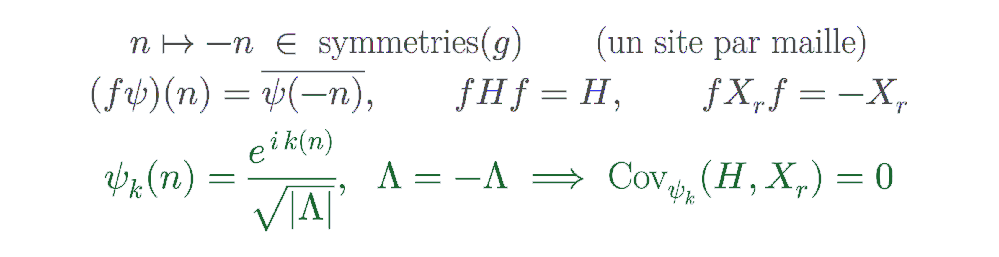</picture></div>

*Module formel :* [`NRS3Cristales/Resumen.lean`](NRS3Cristales/Resumen.lean), section 2.  
*Lemmes :* `PeriodicGraph.inversion_mem_symmetries`, `inversionReversal_hopping`, `inversionReversal_position`, `covariance_hopping_position_unitPlaneWave` ([Crystal/Inversion](https://github.com/naype888-cloud/physlib/blob/cede8e0093b13ea8ec2e8bdeb3984dc275ce0731/PhyslibAlpha/CondensedMatter/Crystal/Inversion.lean), branche `cristales-435`).

---

### Étape 3 : Le petit groupe de chaque moment

> **Proposition 3.1 (Ce que le petit groupe annule).** Si s est dans le petit groupe de χ, que sa partie linéaire A fixe la région et renverse la direction r, alors dans l’onde plane de χ, Σ_HX_r = Ω_HX_r = 0. Aux moments où χ(−n) = χ(n) (le centre et les coins de la zone), Ω_HX = 0 dans toute direction. Le petit groupe fixe Ω comme fonction de la direction : Ω_{H, X_{r∘A⁻¹}} = Ω_{H, X_r}. Sur le réseau carré, au moment diagonal, l’échange des axes donne Ω_{H,X} = Ω_{H,Y} sur le carré {0, …, N}² : la vitesse de groupe pointe le long de la diagonale.

<div align="center"><picture><source media="(prefers-color-scheme: dark)" srcset="assets/oscuro/plaque_cr_etape3.png">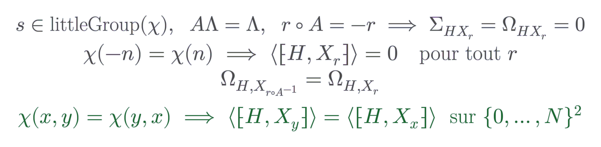</picture></div>

*Module formel :* [`NRS3Cristales/Diagonal.lean`](NRS3Cristales/Diagonal.lean) (`omega_diagonal`, `intercambio`, `intercambioSim`, `intercambio_mem_box`).  
*Lemmes :* `covariance_hopping_position_littleGroup`, `expectation_bracket_hopping_position_littleGroup`, `expectation_bracket_hopping_position_of_neg`, `expectation_bracket_hopping_position_comp_littleGroup` ([Crystal/LittleGroup](https://github.com/naype888-cloud/physlib/blob/cede8e0093b13ea8ec2e8bdeb3984dc275ce0731/PhyslibAlpha/CondensedMatter/Crystal/LittleGroup.lean), branche `cristales-435`), ré-énoncés dans `Resumen.lean`, section 6.

---

### Étape 4 : La taille — la vitesse de groupe de la bande

> **Proposition 4.1 (Le crochet tend vers la vitesse de groupe).** Dans l’onde plane sur une région finie Λ, ⟨⁅H, X_r⁆⟩ = −(t / 2|Λ|) ∑ r(m − n) sin(k(m − n)), somme sur les paires de sites liés de Λ. La bande est ε(k) = −t ∑_δ cos(k·δ), de dérivée t ∑_δ r(δ) sin(k·δ) le long de r. Sur les boîtes {0, …, N}^d, le crochet tend vers −(t/2) ∑_δ r(δ) sin(k·δ) : −½ fois la vitesse de groupe.

<div align="center"><picture><source media="(prefers-color-scheme: dark)" srcset="assets/oscuro/plaque_cr_etape4.png">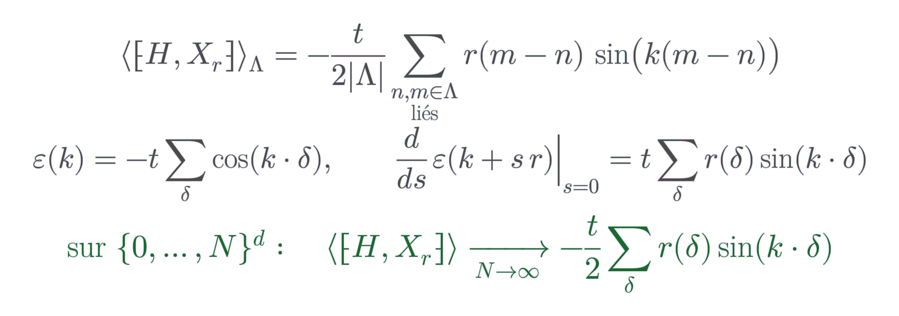</picture></div>

*Module formel :* [`NRS3Cristales/Resumen.lean`](NRS3Cristales/Resumen.lean), section 3.  
*Lemmes :* `expectation_bracket_unitPlaneWave`, `hasDerivAt_band`, `tendsto_expectation_bracket_box` ([Crystal/GroupVelocity](https://github.com/naype888-cloud/physlib/blob/cede8e0093b13ea8ec2e8bdeb3984dc275ce0731/PhyslibAlpha/CondensedMatter/Crystal/GroupVelocity.lean), branche `cristales-435`). La limite utilise la propriété de Følner des boîtes.

---

### Étape 5 : Le pont — Robertson 1934 dans les états de cristal

> **Proposition 5.1 (Robertson pour un état d’une \*-algèbre).** Pour tout état ω d’une \*-algèbre et toute famille d’observables : Robertson–Schrödinger, Cov² + ⟨⁅a, b⁆⟩² ≤ Var a · Var b, et le déterminant de Robertson, |det Ω| ≤ det Σ. Sur la chaîne, dans l’état de courant maximal, Cov(H, X) = 0.

<div align="center"><picture><source media="(prefers-color-scheme: dark)" srcset="assets/oscuro/plaque_cr_etape5.png">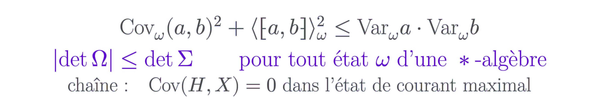</picture></div>

*Module formel :* [`NRS3Cristales/Resumen.lean`](NRS3Cristales/Resumen.lean), sections 4 et 5.  
*Lemmes :* `AlgState.robertson_schrodinger`, `AlgState.robertson_det` ([StarAlgebra/StateUncertainty](https://github.com/leanprover-community/physlib/blob/master/PhyslibAlpha/ProbabilisticTheory/StarAlgebra/StateUncertainty.lean)) et `TightBindingChain.covariance_maxCurrentState` ([MaxCurrentState/UncertaintyRatio](https://github.com/leanprover-community/physlib/blob/master/PhyslibAlpha/CondensedMatter/TightBindingChain/MaxCurrentState/UncertaintyRatio.lean)), fusionnés dans Physlib.

---

### Étape 6 : Un mot ou deux

> **Proposition 6.1 (Commuter, c’est un seul mot).** Deux observables hermitiens A, B commutent si et seulement si ⟨ψ, [A, B]ψ⟩ = 0 dans tout état ; ils ne commutent pas si et seulement si un état unitaire distingue AB de BA. Dans un état unitaire, |⟨[A, B]⟩|² ≤ 4 ‖(A − ⟨A⟩)ψ‖² ‖(B − ⟨B⟩)ψ‖² ; si A, B ne commutent pas, un état donne 0 < Var A · Var B. Sur le cube, deux observables distincts des paires (H, X) des trois axes commutent si et seulement s’ils sont sur des axes différents ; sur le même axe, dans l’état de courant maximal, 0 < Var H · Var X.

<div align="center"><picture><source media="(prefers-color-scheme: dark)" srcset="assets/oscuro/plaque_cr_etape6.png">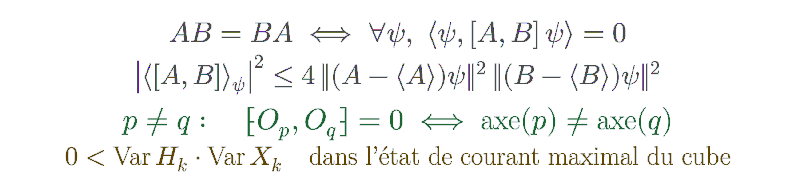</picture></div>

*Module formel :* [`NRS3Cristales/Palabras.lean`](NRS3Cristales/Palabras.lean) (`commute_iff_forall_commutator`, `not_commute_iff_exists_unit`, `commutator_sq_le`, `exists_pos_bound_of_not_commute`).  
*Module formel :* [`NRS3Cristales/PalabrasCubo.lean`](NRS3Cristales/PalabrasCubo.lean) (`bracket_pares_ejes_distintos`, `axisBracket_ne_zero`, `bracket_mismo_eje_ne_zero`, `bracket_eq_zero_iff_ejes_distintos`, `uno_o_dos_palabras`).  
*Physlib :* PR #1986 (deux observables du cube commutent si et seulement s’ils sont sur des axes différents).

---

### Étape 7 : Le complément de Schur — fcc et bcc sont des mots de pas d’axe

> **Proposition 7.1 (Schur exact sur le cube ouvert).** ℤ³ est le graphe de Cayley (addCayley, la version additive de `SimpleGraph.mulCayley` de Mathlib) des six pas d’axe `axisStep` de Physlib : les voisins d’axe sont ses voisins. Le cube ouvert est le produit cartésien de trois chemins de Mathlib, P_Nx □ P_Ny □ P_Nz ; sur chaque axe c’est le saut de la chaîne ouverte (#2096), et ses arêtes sont celles du graphe de Cayley vues dans la boîte. Chaque arête change la parité de x + y + z, donc, avec P les positions paires et Q les impaires, H_PP = H_QQ = 0 est un théorème du cube ouvert, et le complément de Schur est exact avec sa matrice d’adjacence A ; H_PQ H_QP est A² sur les positions paires, c’est-à-dire le nombre de chemins de longueur 2. En général, on sépare les positions en P et Q et le pas d’axe en blocs. Si H_PP = H_QQ = 0, alors det(E − H) = E^|Q| det(E − H_PQ H_QP / E), et Hψ = Eψ si et seulement si ψ_Q = H_QP ψ_P / E et H_PQ H_QP ψ_P = E² ψ_P. Pour fcc (P = somme des coordonnées paire) le pas d’axe change la parité, donc H_PP = H_QQ = 0. Les entrées de H_PQ H_QP comptent les mots de deux pas d’axe : 6 de retour, 2 vers chaque ±eᵢ ± eⱼ, 1 vers chaque ±2eᵢ, et rien d’autre : 6 + 12·2 + 6·1 = 36. Pour bcc, la diagonale de corps (1, 1, 1) n’est atteinte par aucun mot de deux pas et par 6 mots de trois pas. La boîte 3³ contient la maille fcc (14 positions) et la maille bcc (9) ; la boîte 4³, 32 et 16.

<div align="center"><picture><source media="(prefers-color-scheme: dark)" srcset="assets/oscuro/plaque_cr_etape7.png">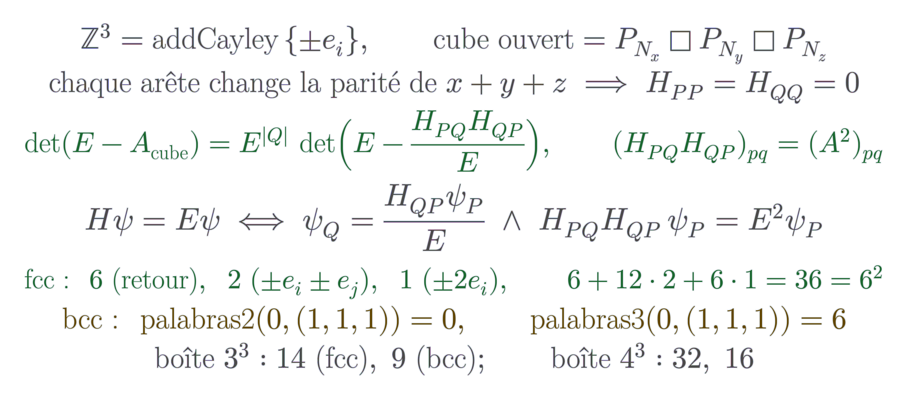</picture></div>

*Module formel :* [`NRS3Cristales/Schur.lean`](NRS3Cristales/Schur.lean) (`redCubica`, `mem_vecinos_iff_adj`, `palabras2_eq_card_fiber`, `palabras2_diagonalCara_fiber`, `det_sub_bipartita`, `schur_bipartita`, `not_even_iff_of_mem_vecinos`, `palabras2_add`, `palabras2_regreso`, `palabras2_diagonalCara`, `palabras2_dobleEje`, `suma_palabras2`, `palabras2_cuerpo`, `palabras3_cuerpo`, `palabras2_adyacentes_Q`, `card_pares_caja_tres`, `card_igualParidad_caja_tres`, `card_pares_caja_cuatro`, `card_igualParidad_caja_cuatro`).  
*Module formel :* [`NRS3Cristales/SchurCubo.lean`](NRS3Cristales/SchurCubo.lean) (`cubo_adj_iff`, `paridad_cubo`, `adyacencia_particion`, `det_cubo_schur`, `dosPasos_eq`).  
*Physlib :* PR #1987 (les pas d’axe `axisStep` et le poids 2, `card_twoStepWords_fiber`, importés ici), PR #2096 (la chaîne ouverte est le saut de `pathGraph`).

---

### Étape 8 : La bande fcc raffinée

> **Proposition 8.1 (Le carré de la bande cubique).** Le symbole de Bloch du pas d’axe est 2 cos k₁ + 2 cos k₂ + 2 cos k₃ ; celui des mots de deux pas en est le carré. Avec les poids du recensement, le symbole de H_PQ H_QP est (2 ∑ cos kᵢ)² = 6 + 8 ∑_{i<j} cos kᵢ cos kⱼ + 2 ∑ cos 2kᵢ. Il est dans [0, 36] et vaut 36 en k = 0 ; le graphe à 12 voisins à saut uniforme vaut −4 en k = (π, 0, 0), où le symbole raffiné vaut 4. Sur les positions de somme paire, l’état de courant maximal du cube a des amplitudes réelles ; avec tout transport effectif réel, sa partie fcc a une tension ⟨i[T, X]⟩ = 0.

<div align="center"><picture><source media="(prefers-color-scheme: dark)" srcset="assets/oscuro/plaque_cr_etape8.png">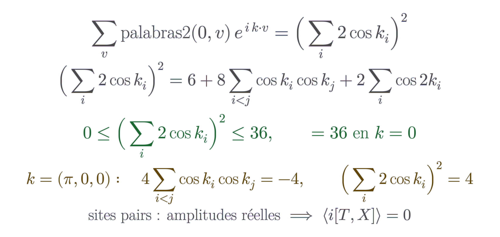</picture></div>

*Module formel :* [`NRS3Cristales/FccRefinado.lean`](NRS3Cristales/FccRefinado.lean) (`simbolo_vecinos`, `simbolo_dospasos`, `simbolo_palabras2`, `banda_fcc_refinada`, `banda_fcc_refinada_eq_pesos`, `banda_fcc_refinada_nonneg`, `banda_fcc_refinada_le`, `banda_fcc_refinada_zero`, `banda_truncada_negativa`).  
*Module formel :* [`NRS3Cristales/SchurCubo.lean`](NRS3Cristales/SchurCubo.lean) (`val_maxCurrentState`, `val_maxCurrentCubeState`, `im_val_maxCurrentCubeState_of_even`, `tension_parteFCC_eq_zero`, `tension_parteFCC_dosPasos`).  
Sur le cube complet, le même état sature la relation de chaque axe à 2 ou 3 positions et est strict dès 4 : dans la boîte 3³ il sature, dans 4³ il rompt. La tension vit dans le pas d’axe P ↔ Q, pas dans la description effective par diagonales.

---

## 🔬 Les contributions Physlib utilisées

| PR Physlib | Fichier | Énoncé | Étape |
|:---:|:---|:---|:---:|
| [PR 1771](https://github.com/leanprover-community/physlib/pull/1771) (Tom Diem) | `Crystal/PointGroup/Cubic`, `Hypercubic` | Groupes ponctuels cubiques : 48 | 1 |
| **#1798** | `Crystal/PointGroup/TetragonalHexagonal` | Tétragonaux 16, hexagonal 24 | 1 |
| **#1802** | `Crystal/PointGroup/Orthorhombic` | Les quatre orthorhombiques : 8 | 1 |
| **#1986** | `TightBindingChain/Cube/AxisCommutation` | Deux observables du cube commutent ⟺ axes différents | 6 |
| **#1987** | `Crystal/Examples/AxisStepWords` | Les voisins de fcc et bcc sont des mots de pas d’axe | 7 |
| **#2096** | `TightBindingChain/Open/Basic` | La chaîne ouverte est le saut du graphe chemin de Mathlib | 7 |
| branche `cristales-435` | `Crystal/Inversion`, `LittleGroup`, `GroupVelocity` | Inversion, petit groupe, vitesse de groupe | 2, 3, 4 |

L’argument complet des liaisons, lemme par lemme, avec ce qui reste ouvert : [ENLACES.md](ENLACES.md).

---

## 📚 Catalogue des modules Lean

| Module | Déclaration principale | Signification | `sorry` |
|:---|:---|:---|:---:|
| [`NRS3Cristales/Resumen.lean`](NRS3Cristales/Resumen.lean) | (ré-énoncés `example`) | Vérification directe des lemmes Physlib de symétrie et vitesse de groupe | 0 |
| [`NRS3Cristales/Diagonal.lean`](NRS3Cristales/Diagonal.lean) | `omega_diagonal` | Égalité des crochets en x et y sur la diagonale du carré | 0 |
| [`NRS3Cristales/Palabras.lean`](NRS3Cristales/Palabras.lean) | `commute_iff_forall_commutator` | Commuter équivaut à un commutateur d’espérance nulle | 0 |
| [`NRS3Cristales/PalabrasCubo.lean`](NRS3Cristales/PalabrasCubo.lean) | `bracket_eq_zero_iff_ejes_distintos` | Deux observables du cube commutent ⟺ axes distincts | 0 |
| [`NRS3Cristales/Schur.lean`](NRS3Cristales/Schur.lean) | `schur_bipartita` | Complément de Schur bipartite et mots de deux/trois pas d’axe | 0 |
| [`NRS3Cristales/SchurCubo.lean`](NRS3Cristales/SchurCubo.lean) | `tension_parteFCC_eq_zero` | Tension nulle de la partie fcc de l’état de courant maximal | 0 |
| [`NRS3Cristales/FccRefinado.lean`](NRS3Cristales/FccRefinado.lean) | `banda_fcc_refinada` | Bande fcc raffinée égale au carré de la bande cubique | 0 |

### Portée

* Les lemmes d’inversion, petit groupe et vitesse de groupe proviennent de la branche `cristales-435` du fork `naype888-cloud/physlib` (`cede8e00`) ; les groupes ponctuels, Robertson et `axisStep` sont fusionnés dans `leanprover-community/physlib`.

---

## 🏛️ La mosaïque

| Dépôt | Objet |
|:---|:---|
| [`00 · bacqm-substrate`](https://github.com/naype888-cloud/bacqm-systems) | Substrat matériel & moteur du noyau Linux : modules de mémoire dynamiques en temps réel |
| [`01 · nava-robertson-schrodinger`](https://github.com/naype888-cloud/nava-robertson-schrodinger) | Le canon : l'incertitude élémentaire dimensionnelle sur le cube ouvert, ℂᵈ ⊗ ℂᵈ ⊗ ℂᵈ |
| [`02 · Proper-Time-General-Relativity`](https://github.com/naype888-cloud/Proper-Time-General-Relativity) | Le temps compte les pas : τ = 1/(φ\|t\|) à quatre sites ; masse effective, équivalence, gravitation |
| [`03 · nrs3-mandelstam-tamm-cramer-rao`](https://github.com/naype888-cloud/nrs3-mandelstam-tamm-cramer-rao) | Mandelstam–Tamm et Cramér–Rao : aucun état n'est orthogonal à lui-même avant πħ/(2ΔE) |
| [`04 · YM-By-Perelmans-surgery-method`](https://github.com/naype888-cloud/YM-By-Perelmans-surgery-method) | Yang–Mills sur réseau : loi d'aire uniforme, matrice de transfert, défaut de fibre (0 sorry) |
| [`05 · nrs3-tightbinding`](https://github.com/naype888-cloud/nrs3-tightbinding) | La chaîne de Physlib, le cube ouvert et la table périodique (H–Og), un cube 3D par élément |
| [**06 · nrs3-cristales**](https://github.com/naype888-cloud/nrs3-cristales) | Cristaux : la symétrie donne la forme de Σ et Ω, le spectre donne la taille *(ce dépôt)* |
| [`07 · nrs3-completude`](https://github.com/naype888-cloud/nrs3-completude) | Complétude constructive et limites spectrales par Robertson–Fiedler–Niven–Szegő |
| [`08 · nrs3-golab`](https://github.com/naype888-cloud/nrs3-golab) | Gołąb, les deux extrêmes : π = 3 (hexagone), 4 (carré) ; produit scalaire → π exact ; stabilité en d = 3 |
| [`09 · nrs3-de-sitter`](https://github.com/naype888-cloud/nrs3-de-sitter) | Cosmologie de Sitter : rayon d'horizon L_dS, constante cosmologique positive et courbure |
| [`10 · nrs3-bekenstein`](https://github.com/naype888-cloud/nrs3-bekenstein) | Thermodynamique des trous noirs : frontière à bits, entropie de Bekenstein–Hawking saturée |
| [`11 · nrs3-landauer-carnot`](https://github.com/naype888-cloud/nrs3-landauer-carnot) | Limite de Landauer et cycle de Carnot : coût d'effacement d'un bit et dissipation minimale |
| [`12 · nrs3-penrose`](https://github.com/naype888-cloud/nrs3-penrose) | Effondrement gravitationnel de Diósi–Penrose : temps de décohérence par auto-énergie |
| [`13 · nrs3-rovelli-lqg`](https://github.com/naype888-cloud/nrs3-rovelli-lqg) | Gravité quantique à boucles : spectre d'aire discrète, opérateur de surface et saturation de spin |
| [`14 · nrs3-uncertainty-cone`](https://github.com/naype888-cloud/nrs3-uncertainty-cone) | Cône de lumière futur et cercle de Minkowski : structure causale sous revêtement SL(2, ℂ) |
| [`15 · lean4-commits`](https://github.com/naype888-cloud/lean4-commits) | 53 PRs fusionnées dans leanprover-community/physlib : catalogue de preuves formelles, 0 sorry, ZFC |

---

## ⏱️ Chronologie historique (1911–1945)

| Année | Événement | Ici |
|:---:|:---|:---|
| **1917** | Schur : le complément d’une matrice par blocs | `schur_bipartita` |
| **1928** | Bloch : ondes de Bloch et bandes | `planeWave`, `band` |
| **1929–30** | Robertson et Schrödinger : l’inégalité d’incertitude | `AlgState.robertson_schrodinger` |
| **1930** | Brillouin : la zone de Brillouin | `hasDerivAt_band` |
| **1931–32** | Wigner : théorie des groupes ; le renversement du temps est antiunitaire | `inversionReversal` |
| **1934** | Robertson : le déterminant pour plusieurs observables | `AlgState.robertson_det` |
| **1936** | Bouckaert, Smoluchowski et Wigner : le petit groupe de chaque k | `covariance_hopping_position_littleGroup` |

**Antécédents et outils hors de la fenêtre.** Bravais (1848), Cayley (1878), Følner (1955), Lean 4, Mathlib et Physlib.
---

## 🛠️ Compilation et certification

```bash
lake build
lake env lean Verification/Axioms.lean
node tools/check_core.js          # le modèle numérique du site contre les formules des lemmes
node tools/gen_formal_tables.js   # régénère les tables de la note formelle depuis le même noyau
```

lakefile.toml fixe Physlib au commit `cede8e00` de [naype888-cloud/physlib](https://github.com/naype888-cloud/physlib/tree/cristales-435) (Lean 4.35). Tous les résultats ne dépendent que de :

```text
[propext, Classical.choice, Quot.sound]
```

* **0 `sorry`**, aucun axiome propre.
---

## 📜 Licence

NRS Noncommercial License 1.0.0, voir [LICENSE](LICENSE). Auteur : Eduardo Nava-Hernandez.

---

<div align="center">

### 📐 *« La symétrie donne la forme de Σ et Ω, le spectre donne la taille, et le seul mouvement élémentaire, le pas d’axe, engendre fcc et bcc. »*

**Eduardo Nava Hernández** · [naype888-cloud](https://github.com/naype888-cloud)

</div>

</div>
