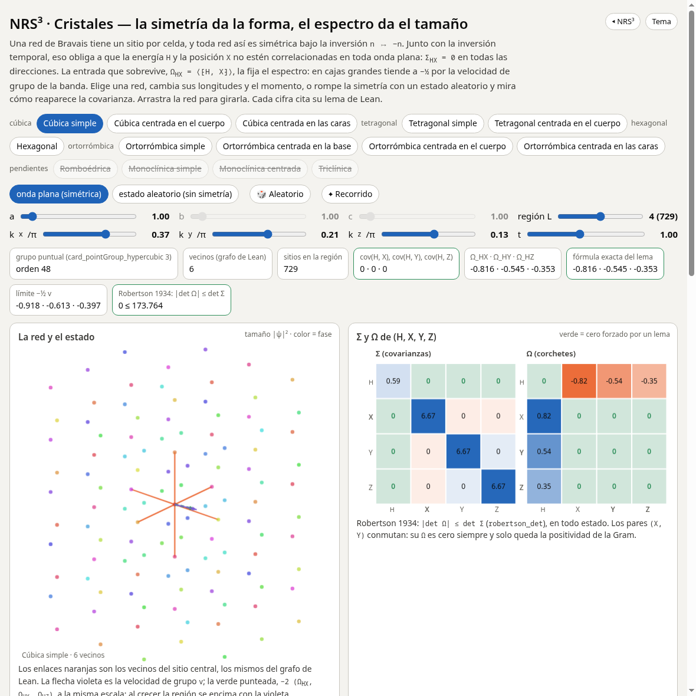

# RS^N³ · Cristales

**La simetría da la forma de `Σ` y `Ω`; el espectro da el tamaño.** Toda red de Bravais es
simétrica bajo la inversión `n ↦ −n`. Junto con la inversión temporal, eso obliga a que la
energía y la posición no estén correlacionadas en toda onda plana: `Σ_HX = 0` en todas las
direcciones. La entrada que sobrevive, `Ω_HX = ⟨⁅H, X⁆⟩`, es exactamente una suma sobre los
enlaces de la región, y en cajas grandes tiende a `−½` por la velocidad de grupo de la banda.
Robertson 1934, `|det Ω| ≤ det Σ`, vale también para los estados de cristal de un álgebra sin
norma. Lean 4 sobre Physlib (rama `mosaic-cristales` del fork).

**[▶ El sitio](https://naype888-cloud.github.io/nrs3-cristales/)** · [Didáctica, en ocho pasos](https://naype888-cloud.github.io/nrs3-cristales/didactic/) · [Nota formal, con el libro de lemas](https://naype888-cloud.github.io/nrs3-cristales/formal/) · [Laboratorio: las 14 redes con todos sus parámetros](https://naype888-cloud.github.io/nrs3-cristales/lab/)

El cubo de `N` sitios por eje se muestra con su `C_N`: `= 1` solo en `N = 2, 3` (Robertson satura), **estrictamente `> 1` desde `N = 4`**, creciente (monotonía analítica por cotas de Taylor y polinomios de Bernstein, PhyslibAlpha #1735) y con límite `C_N^∞ = √(π²/3 − 2)` (#1734) que no se alcanza.



## Los enlaces y la revisión con Tom

La diagonal no es un paso primitivo con operador propio, pero sí un enlace efectivo bien definido: es la única palabra de segundo orden con dos
ejes, y los dos órdenes coinciden porque los ejes conmutan. El argumento completo, con cada lema, lo que no está probado y qué proponer en el
PR 4, está en [`ENLACES.md`](ENLACES.md). El plan de 9 PR y cuáles van a revisión de Tom, en su §6: hoy el que está abierto para su revisión es
[#1972](https://github.com/leanprover-community/physlib/pull/1972).

## Resultados

Cada enunciado se repite, con su prueba, en [`NRS3Cristales/Resumen.lean`](NRS3Cristales/Resumen.lean).

### Las redes y sus grupos puntuales

| Red | Vecinos | Orden del grupo puntual | Lean |
|---|---|---|---|
| cúbica simple, centrada en el cuerpo, centrada en las caras | 6, 8, 12 | 48 | `card_pointGroup_hypercubic`, `bcc_card_pointGroup`, `fcc_card_pointGroup` |
| tetragonal simple y centrada en el cuerpo | 10, 16 | 16 | `tetragonal_card_pointGroup`, `bodyCentredTetragonal_card_pointGroup` |
| hexagonal | 8 | 24 | `hexagonal_card_pointGroup` |
| ortorrómbicas P, C, I, F | 12, 12, 14, 18 | 8 (las 8 operaciones, explícitas) | `orthorhombic_card_pointGroup` y las otras tres |

Las catorce redes de Bravais están: la romboédrica, las dos monoclínicas y la triclínica se fusionaron en PhyslibAlpha (#1823, #1825). Diamante y panal están en la rama `feat-physlibalpha-crystal-diamond-honeycomb` del fork.

### La forma: la simetría anula entradas

| Enunciado | Lean |
|---|---|
| estado invariante bajo una simetría que fija `A` e invierte `B`: `Σ_AB = Ω_AB = 0` | `covariance_eq_zero_of_symm`, `expectation_bracket_eq_zero_of_symm` |
| con la inversión temporal: `Σ` se anula entre paridades distintas, `Ω` dentro de una misma | `covariance_eq_zero_of_reverse`, `expectation_bracket_eq_zero_of_reverse` |
| un antiunitario `f` con `f ∘ f = id` y un estado fijo: par e impar sin correlación | `covariance_ofVec_eq_zero_of_antiunitary` |
| toda red con un sitio por celda es centrosimétrica | `PeriodicGraph.inversion_mem_symmetries` |
| inversión por inversión temporal: `f H f = H`, `f X f = −X` | `inversionReversal_hopping`, `inversionReversal_position` |
| en toda onda plana, `Σ_HX = 0` en todas las direcciones | `covariance_hopping_position_unitPlaneWave` |
| cadena: `cov(H, X) = 0` en el estado de corriente máxima, por la simetría partícula–hueco | `covariance_maxCurrentState` |
| grupo pequeño de `k`: una operación que fija `k` e invierte `r` da `Σ_HX = Ω_HX = 0` en la onda plana; la velocidad de grupo a lo largo de `r` se anula | `covariance_hopping_position_littleGroup`, `expectation_bracket_hopping_position_littleGroup` |
| en `Γ` y en las esquinas de la zona (`χ(−n) = χ(n)`) la inversión está en el grupo pequeño: `Ω_HX = 0` en toda dirección | `expectation_bracket_hopping_position_of_neg` |
| el grupo pequeño fija `Ω_HX` como función de la dirección, `Ω_{H, X_{r∘A⁻¹}} = Ω_{H, X_r}`, y la `Σ` de las posiciones: la velocidad de grupo está en el subespacio fijo | `expectation_bracket_hopping_position_comp_littleGroup`, `covariance_position_comp_littleGroup` |
| red cuadrada, momento en la diagonal: `Ω_{H,X} = Ω_{H,Y}` en el cuadrado `{0, …, N}²` | `NRS3Cristales.omega_diagonal` (este repo, `Diagonal.lean`) |

### El tamaño: lo que sobrevive lo fija el espectro

| Enunciado | Lean |
|---|---|
| `Ω_HX = −(t / 2\|Λ\|) Σ_enlaces r(m − n) sin(k·(m − n))` en una región finita | `expectation_bracket_unitPlaneWave` |
| la banda `ε(k) = −t Σ_δ cos(k·δ)` y su velocidad de grupo | `band`, `hasDerivAt_band` |
| en las cajas `{0, …, N}^d`, `Ω_HX → −½ v` | `tendsto_expectation_bracket_box` |

### El puente: Robertson 1934 en los estados de cristal

| Enunciado | Lean |
|---|---|
| Robertson–Schrödinger y `\|det Ω\| ≤ det Σ` para un estado de cualquier `*`-álgebra | `AlgState.robertson_schrodinger`, `AlgState.robertson_det` |
| en el estado térmico invariante por traslación de una interacción en `ℤ^d` | `robertson_det_translationInvariantState` |
| traslación que fija `A` e invierte `B` (el antiferromagneto): `Σ_AB = Ω_AB = 0` | `covariance_translationInvariantState_eq_zero` |

En una caja finita, el valor óptimo exacto de `Ω_HX` es el espectro finito. Para cajas que son
producto de caminos es el `cos(π/(N+1))` de la cadena y del cubo, ya fusionado en Physlib. En
FCC o BCC la caja no se descompone en caminos y su espectro no tiene fórmula cerrada; lo que vale
para todas las redes es el límite, la banda.

## Construir

```
lake build
lake env lean Verification/Axioms.lean
node tools/check_core.js          # el modelo numérico del sitio contra las fórmulas de los lemas
node tools/gen_formal_tables.js   # regenera las tablas de la nota formal desde el mismo núcleo
```

`lakefile.toml` fija Physlib en el commit `6aa4163f` de
[`naype888-cloud/physlib`](https://github.com/naype888-cloud/physlib/tree/mosaic-cristales).
Solo se esperan los axiomas `propext`, `Classical.choice` y `Quot.sound`.

## Línea de tiempo 1911–1945

| Año | Evento | Aquí |
|---|---|---|
| 1915–20 | Szegő: los teoremas límite de las matrices de Toeplitz | el límite de la banda |
| 1928 | Bloch: las ondas de Bloch y las bandas | `planeWave`, `band` |
| 1929–30 | Robertson y Schrödinger: la desigualdad de incertidumbre | `AlgState.robertson_schrodinger` |
| 1930 | Brillouin: la zona de Brillouin | `hasDerivAt_band` |
| 1931–32 | Wigner: teoría de grupos en la mecánica cuántica; la inversión temporal es antiunitaria | `SymmetricState`, `Antiunitary` |
| 1934 | Robertson: el determinante para varios observables | `AlgState.robertson_det` |
| 1936 | Bouckaert, Smoluchowski y Wigner: la simetría de las bandas, el grupo pequeño de cada `k` | la forma de `Σ` y `Ω` según `k` |

**Antecedentes y herramientas fuera de la ventana.** Bravais (1848), Følner (1955), Fiedler
(1973), Lean 4, Mathlib y Physlib.

## El mosaico

- [RS^N y RS^N³ — el teorema base](https://github.com/naype888-cloud/nava-robertson-schrodinger)
- [RS^N³ · Mandelstam–Tamm y Cramér–Rao](https://github.com/naype888-cloud/nrs3-mandelstam-tamm-cramer-rao)
- [RS^N³ · Landauer y Carnot](https://github.com/naype888-cloud/nrs3-landauer-carnot)
- [RS^N³ · de Sitter](https://github.com/naype888-cloud/nrs3-de-sitter)
- [RS^N³ · Penrose](https://github.com/naype888-cloud/nrs3-penrose) (propuesta)
- [RS^N³ · Pauli–Dirac](https://github.com/naype888-cloud/nrs3-pauli-dirac)
- [RS^N³ · El cono de la incertidumbre](https://github.com/naype888-cloud/nrs3-uncertainty-cone)
- [RS^N³ · Poincaré](https://github.com/naype888-cloud/nrs3-poincare)
- [RS^N³ · Defecto y curvatura](https://github.com/naype888-cloud/nrs3-defect-curvature)
- [RS^N³ · Rovelli — Loop Quantum Gravity](https://github.com/naype888-cloud/nrs3-rovelli-lqg) (propuesta)
- [RS^N³ · Dark](https://github.com/naype888-cloud/nrs3-dark)
- **[RS^N³ · Cristales](https://github.com/naype888-cloud/nrs3-cristales)** (este)

## Licencia

NRS Noncommercial License 1.0.0, ver [`LICENSE`](LICENSE). Autor: Eduardo Nava-Hernandez.
